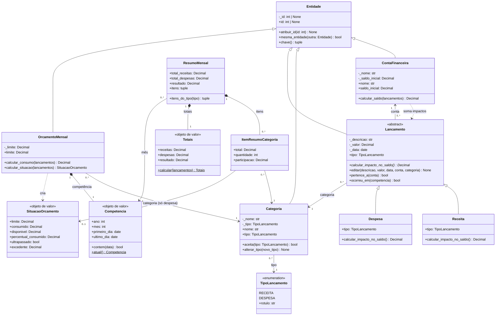
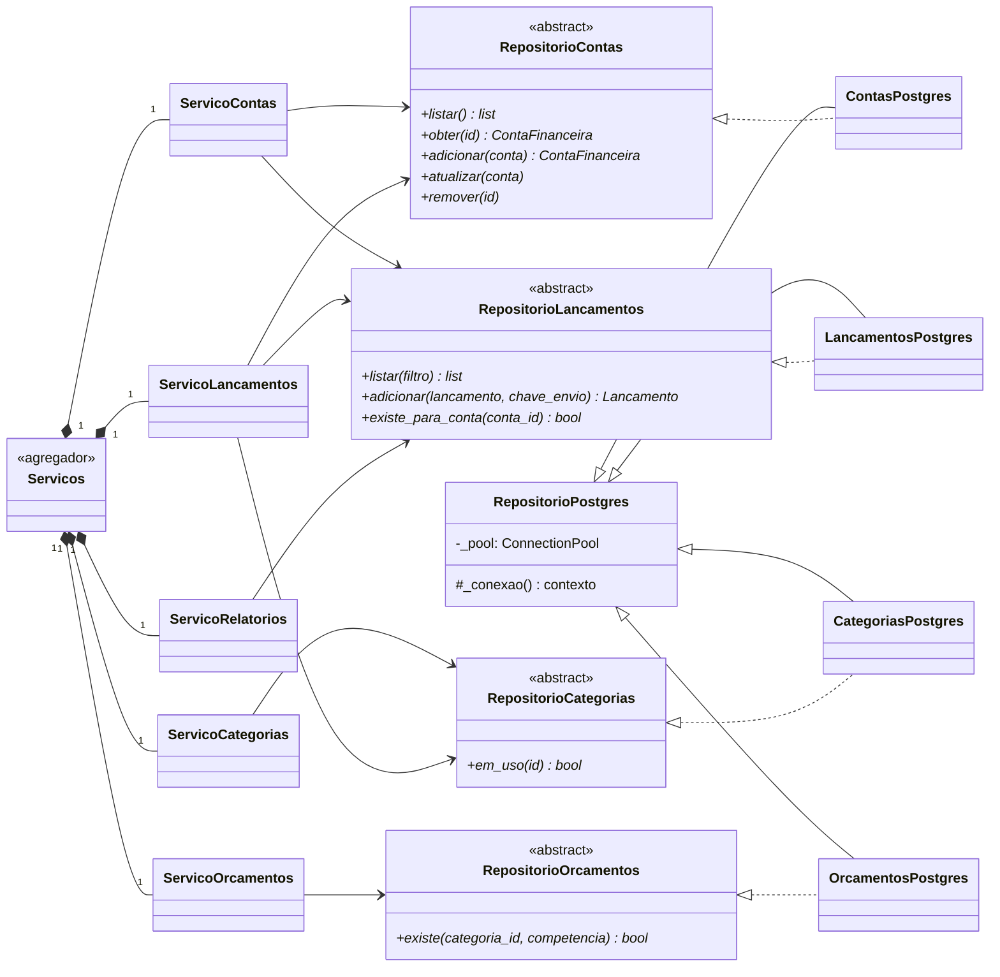

# Diagrama de classes — Happy Green

Diagramas em Mermaid (o GitHub os desenha automaticamente). Nomes, atributos e
métodos correspondem ao código em `happy_green/`.

## 1. Domínio (`happy_green/dominio`)

Leitura das relações:

| Relação | Tipo | Por quê |
|---|---|---|
| `Lancamento` → `ContaFinanceira` / `Categoria` | Associação (N:1) | A conta e a categoria existem por conta própria; vários lançamentos apontam para elas. |
| `OrcamentoMensal` ◆ `Competencia` | Composição (1:1) | A competência é um objeto de valor sem identidade; não existe fora do orçamento. |
| `ResumoMensal` ◆ `ItemResumoCategoria` | Composição (1:N) | O resumo cria e guarda seus itens; eles somem com o resumo. |
| `Receita`/`Despesa` ▷ `Lancamento` ▷ `Entidade` | Herança | Reaproveitam validação e identidade; sobrescrevem `calcular_impacto_no_saldo()` e `tipo`. |

## 2. Serviços e repositórios

Os serviços dependem dos **contratos abstratos**; a aplicação injeta as
implementações PostgreSQL (`montar_repositorios_postgres`) e os testes injetam
implementações em memória (`tests/fakes.py`). Cada classe `*Postgres` herda de
duas bases: `RepositorioPostgres` (pool e tradução de erros) e o contrato.
